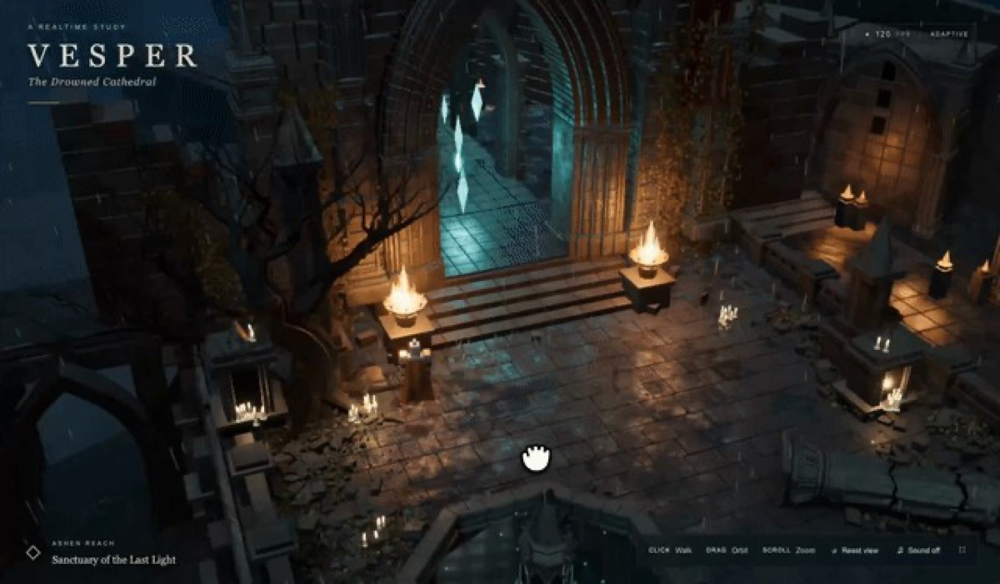

# Advanced: game-quality Three.js with agent loops

Two open repos turn a coding agent into a game art pipeline. Use them together.

- dream-loop by @anshuc: https://github.com/achimala/dream-loop
- Agent Skills by Meng To: https://github.com/MengTo/Skills



Live demo: https://dream-loop-demo.anshu.dev

## 1. dream-loop

A skill that closes the loop between a target image and the running build.

1. Dream. The agent generates a high-quality target screenshot with image generation.
2. Build. It writes the Three.js scene aimed at that target.
3. Critique. A separate critic agent screenshots the live build, compares it to the target and lists gaps.
4. Loop. Back to Build until the critic passes.
5. Raise the bar (optional). Dream a better target from the current state and repeat.

Requirements: an agent with image generation (built in, or a Gemini API key), vision input, and subagents (preferred). Blender with its MCP or Python scripting for custom models.

Install:

```bash
npx skills add achimala/dream-loop
```

Or clone it into the agent skills folder (`~/.claude/skills/dream-loop` for Claude Code).

Example prompt from the repo, which produced Vesper in about an hour:

> Build me a graphics demo: isometric camera, voxel-ish art style with realistic shading and reflective wet floors, a character in an interesting scene. Fantasy setting (think Elden Ring, Diablo). Three.js in browser, >60fps. Don't download assets. Time limit of 1 hour. Controls: click to move the character.

## 2. Agent Skills (MengTo/Skills)

Portable `SKILL.md` playbooks the agent reads before it acts. Folders worth loading for a game:

| Folder | Use it for |
|---|---|
| `game-development/build-isometric-arpg` | Isometric ARPG base: camera, movement, click to move |
| `game-development/build-ultra-realistic-game-interiors` | Lit, detailed rooms |
| `game-development/game-dev-character-model` | Concept image to rigged, posed hero |
| `game-development/design-action-combat`, `build-threejs-enemy-systems`, `tune-enemy-ai` | Combat and enemies |
| `game-development/optimize-threejs-games`, `test-playable-web-games`, `ship-web-games` | 60 fps, QA, deploy |
| `game-combat/fire-smoke-skill-vfx`, `lightning-energy-skill-vfx`, `ice-frost-skill-vfx`, `water-crystal-skill-vfx` | Spell VFX in one visual language |
| `game-combat/game-dev-combat-skill-polish` | Blind-judged scoring of skills against a reference |
| `3d/*` | Water, god rays, skies, high-res textures, Retina rendering |

Install for Claude Code:

```bash
git clone https://github.com/MengTo/Skills ~/src/mengto-skills
cp -r ~/src/mengto-skills/agent-skills/game-development/* ~/.claude/skills/
cp -r ~/src/mengto-skills/agent-skills/game-combat/* ~/.claude/skills/
```

For Codex or Cursor, point the agent at the skill folder and tell it to read `SKILL.md` first.

## 3. Hackathon recipe (2 to 3 hours)

1. Pick one scene and one verb: "drowned cathedral, click to move, cast lightning".
2. Load `build-isometric-arpg` and dream-loop. Run the dream-loop prompt with your scene.
3. Gate on the critic: no new features until the scene scores well against the target.
4. Add one spell with a `game-combat/*-skill-vfx` skill. One effect, finished.
5. Run `optimize-threejs-games` to hold 60 fps, then `test-playable-web-games`.
6. Deploy with `ship-web-games` (Vercel or GitHub Pages).

## Rules that keep quality high

- The target image is the spec. Keep it in the repo and show it to the critic every round.
- Builder and critic are separate agents. The builder never grades its own frame.
- Generate assets in code or Blender. Downloaded packs break the style.
- Set a frame budget (60 fps) and a time limit in the first prompt.
- Change one or two things per iteration.
